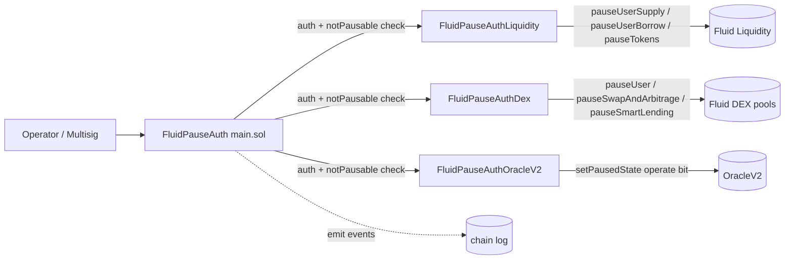

# Config / pauseAuth — SPEC

## 1. Purpose

Emergency pause system for the Fluid protocol. Provides a single, unified operator entry point to pause / unpause **vaults, DEXes, tokens, users, swap & arbitrage, smart lending, and OracleV2 operate prices** across the Liquidity, DEX and OracleV2 layers.

Implemented as four contracts:

| Contract | File | Role |
| --- | --- | --- |
| `FluidPauseAuth` | `main.sol` | Entry point. Auth, routing, event emission. |
| `FluidPauseAuthLiquidity` | `pauseAuthLiquidity.sol` | Liquidity-layer executor. Returns data, emits no operational events. |
| `FluidPauseAuthDex` | `pauseAuthDex.sol` | DEX-layer executor. Returns data; emits only its borrow-limit freeze events. |
| `FluidPauseAuthOracleV2` | `pauseAuthOracleV2.sol` | OracleV2 executor. Returns acted flags, emits no operational events. |

`FluidPauseAuth` is the only contract operators interact with. The executors are narrow helpers that perform the actual Liquidity / DEX / OracleV2 calls and return structured bools; `FluidPauseAuth` consumes those bools and emits the user-facing events from a single place.

## 2. Architecture & Data Flow

Each operational call: `caller → FluidPauseAuth` (auth + `notPausable*` checks) → executor (execute + return structured bools) → `FluidPauseAuth` (emit events).

### Liquidity user class (current scope)

**At the moment, Liquidity user class (0 / 1 / 2) is enforced only on the Liquidity layer** — i.e. in `FluidPauseAuthLiquidity` when calling Fluid Liquidity `pauseUserSupply` / `pauseUserBorrow`. It is **not** applied on the DEX executor (`FluidPauseAuthDex`): vault/DEX/smart-lending pause on connected DEX pools proceeds regardless of the address’s LL class. `LogSkipVaultUserClass` / `LogSkipDexUserClass` reflect LL skip/strip only, not DEX behaviour. See §11 for detail.

## 3. External Interactions

- `FluidPauseAuthLiquidity` is registered as a **guardian** on Fluid Liquidity (so it can call `pauseUserSupply` / `pauseUserBorrow`, their unpause pair, and `pauseTokens` / `unpauseTokens`).
- `FluidPauseAuthDex` is registered as a **global auth** on the Fluid DEX Factory (so it can call the DEX admin module's `pauseUser` / `pauseSwapAndArbitrage` / `pauseSmartLending` paths).
- `FluidPauseAuthOracleV2` is registered as a **guardian** on OracleV2 (the `FluidUsdOracle` proxy; operate pause bit only; the oracle rejects any guardian change to the liquidate bit).
- `FluidPauseAuth` itself needs no on-chain privilege — all privileged calls go through the three executors.
- Reads Liquidity row existence per user/token and user class, and per DEX `dexVariables2` (enable bits, bit 255) plus each user's side bit and borrow config, for the pre-filter and freeze logic.
- Reads vault / DEX constants to determine which side goes through Liquidity vs DEX (T1 vault shape vs newer shapes).

## 4. Roles & Access Control

### On `FluidPauseAuth`

| Modifier | Who passes |
| --- | --- |
| `onlyAuthLevelHigh` | `AUTH_GATE.requireAuthLevelHigh(sender)` — HIGH tier (team multisig; governance qualifies too). Reverts the gate's `Access__Unauthorized`. |
| `onlyPauseAuth(levelRequired)` | Effective pause-auth level `>= levelRequired`, where effective level = `max(pauseAuths[sender], gate-implied level)` — MID tier (team multisig 2) implies level 2, HIGH tier (team multisig, governance) implies level 3 |

"Multisig" below always means this HIGH tier at the gate.

`pauseAuths[addr]` levels (named constants `PAUSE_AUTH_LEVEL_BOT/MANUAL/UNPAUSE` on the `PauseAuthLevels`
abstract in `main.sol`, which also owns the tier modifiers and the gate→pause-level translation
`_pauseAuthLevel`):

- `0` — not an auth (default).
- `1` — **bot**: can pause new borrows and DEX swap/arbitrage on allowed vaults/DEXes. Cannot pause deposit/supply, withdraw, or payback; cannot pause tokens or smart lending supply/withdraw; cannot unpause. Borrow-only is its only legal shape: a per-operation pause bit on Liquidity legs, a **borrow-limit freeze** on DEX legs (§11), so it covers T1–T4.
- `2` — **manual**: level 1 + can pause deposit/supply, withdraw, payback, allowed tokens, smart lending, and OracleV2 operate prices; cannot unpause. **Team multisig 2 holds this level implicitly** (MID tier at the gate).
- `3` — **unpause tier**: level 2 + can unpause and demote level 1 auths. **The HIGH gate tier (team multisig, governance) holds this level implicitly**; local assignment is expected to stay unset unless explicitly granted by multisig.

The multisig **always bypasses** the `notPausable*` allow-lists; level 1/2/3 auths respect them.

### Permission matrix

| Role | Can Pause | Can Unpause | Can Admin |
| --- | --- | --- | --- |
| Team multisig (HIGH tier, implicit level 3) | Everything (bypasses notPausable) | Everything (incl. user-unpause) | `setPauseAuth`, `setNotPausable*`, `removeClass1` |
| Team multisig 2 (MID tier, implicit level 2) | Same as level 2 (respects notPausable) + user-pause pass-throughs (no notPausable check) | — | — |
| Level 1 auth | New borrows (Liquidity pause bit / DEX borrow-limit freeze) + DEX swap/arbitrage on allowed vaults/DEXes | — | — |
| Level 2 auth | Level 1 + deposit/supply, withdraw, payback, tokens, smart lending, OracleV2 operate | — | — |
| Level 3 auth | Same as level 2 | Everything except user unpauses (HIGH only); respects notPausable | `removeClass1PauseAuth` |

User-level pass-through **pauses** (`pauseUserSupplyLiquidity`, `pauseUserBorrowLiquidity`, `pauseUserDex`) are **MID tier** (`onlyAuthLevelMid` — team multisig 2 and above); the matching **unpause** methods stay **HIGH tier** (`onlyAuthLevelHigh`).

### On executors

Each executor accepts operational calls only from `pauseAuthContract`, a single-immutable-after-set pointer:

- `setPauseAuthContract(addr)` — `AUTH_GATE.requireAuthLevelMid` gated (reverts `Access__Unauthorized`), **set-once, permanently locked**. Reverts if already set (`PauseAuth/Dex__InvalidParams`) or `addr == 0` (shared `BasicValidations__AddressZero`).

## 5. Storage Layout

### `FluidPauseAuth`

| Mapping | Type | Meaning |
| --- | --- | --- |
| `pauseAuths` | `address => uint256` | 0 = none, 1 = new-borrow + DEX swap/arbitrage pause, 2 = level 1 + deposit/withdraw/payback + tokens + smart lending, 3 = level 2 + unpause + remove-class1 |
| `notPausableVaultIds` | `uint256 => bool` | true ⇒ vault exempt from pause auth pausing |
| `notPausableDexIds` | `uint256 => bool` | true ⇒ DEX exempt |
| `notPausableTokens` | `address => bool` | true ⇒ token exempt |

Immutables: `LIQUIDITY`, `VAULT_FACTORY`, `DEX_FACTORY`, `PAUSE_AUTH_LIQUIDITY`, `PAUSE_AUTH_DEX`, `PAUSE_AUTH_ORACLE_V2`, `AUTH_GATE` (identity registry — see [../authGate/SPEC.md](../authGate/SPEC.md); replaces the previously hardcoded `TEAM_MULTISIG`). The executors carry `AUTH_GATE` too.

### Executors

`pauseAuthContract` (address, set-once) on all three. `FluidPauseAuthDex` additionally holds `dexUserBorrowSnapshot[dex][user]`: the borrow config bits (162–235 of the pool's user borrow word) saved by a borrow-limit freeze and cleared by the next borrow unpause (§11).

## 6. Admin / Routing Methods (`FluidPauseAuth`)

### Multisig-only admin

| Method | Behaviour |
| --- | --- |
| `setPauseAuth(addr, class)` | Set auth level (0/1/2/3). Reverts `PauseAuth__InvalidParams` on `class > 3`; `addr == 0` reverts the shared `BasicValidations__AddressZero` (72001) via the `validAddress` modifier. |
| `setNotPausableVaultId(id, bool)` | Toggle vault pausability. Reverts if vault not deployed. |
| `setNotPausableDexId(id, bool)` | Toggle DEX pausability. Reverts if DEX not deployed. |
| `setNotPausableToken(addr, bool)` | Toggle token pausability. Reverts on `addr == 0`. |

### Level-3 only

| Method | Behaviour |
| --- | --- |
| `removeClass1PauseAuth(addr)` | `onlyPauseAuth(3)`. Demote a level 1 auth to 0. Reverts if target is not level 1. |

### Vault pause / unpause

| Method | Auth | Routes to |
| --- | --- | --- |
| `pauseVault(id)` | `onlyPauseAuth(2)` | Liquidity side + DEX side; pauses all four operations |
| `pauseVault(id, supply, withdraw, borrow, payback)` | `onlyPauseAuth(1)` + `_validatePauseFlags` | Liquidity side + DEX side. Level 1 may set `borrow` only; `supply`, `withdraw` or `payback` require level 2+ |
| `unpauseVault(id, supply, withdraw, borrow, payback)` | `onlyPauseAuth(3)` | Both |
| `pauseVaults(ids[], supply[], withdraw[], borrow[], payback[])` | `onlyPauseAuth(1)` | Batch; arrays same length |
| `unpauseVaults(ids[], supply[], withdraw[], borrow[], payback[])` | `onlyPauseAuth(3)` | Batch |

Internal flow per id:

1. Revert if none of `supply`, `withdraw`, `borrow`, or `payback` is requested (`InvalidParams`).
2. Revert if `notPausableVaultIds[id]` and caller is not multisig.
3. `_validatePauseFlags` — revert `Unauthorized` if `supply`, `withdraw` or `payback` is requested by a caller below level 2 (pause path only; unpause is level 3 throughout and skips this check).
4. Call `PAUSE_AUTH_LIQUIDITY.pauseVault / unpauseVault` → emit `LogPauseVault` / `LogUnpauseVault` / `LogSkipVaultUserClass` based on returned bools. `LogSkipVaultUserClass` is emitted when Liquidity user-class rules changed the request (class 2 skips the LL pause entirely; class 1 clears withdraw/payback on pause). The returned bools mean at least one targeted Liquidity token changed pause state for that operation.
5. Call `PAUSE_AUTH_DEX.pauseVault / unpauseVault` → emit `LogPauseVault` / `LogUnpauseVault` for DEX-side changes only (no Liquidity user-class skip on this leg). A borrow-only request on a DEX leg reports `actedBorrow` for a limits freeze / restore with `actedPayback` false; it never touches the pause bit (§7).

### DEX pause / unpause

| Method | Auth | Behaviour |
| --- | --- | --- |
| `pauseDex(id)` | `onlyPauseAuth(2)` | All four Liquidity operations + DEX `swapAndArbitrage`. |
| `pauseDex(id, supply, withdraw, borrow, payback, swapArb)` | `onlyPauseAuth(1)` + `_validatePauseFlags` | Combines Liquidity operation pause + DEX `swapAndArbitrage` toggle. Level 1 may set `borrow` and/or `swapArb` only. |
| `unpauseDex(...)` | `onlyPauseAuth(3)` | As above. |
| `pauseDexes(ids[], ...)` / `unpauseDexes(...)` | as above | Batch forms. |

Internal flow: revert if no flag set; respect `notPausableDexIds` (multisig bypass); dispatch supply/withdraw/borrow/payback to `PAUSE_AUTH_LIQUIDITY.pauseDex`, which pauses the pool itself as a Liquidity user (§11), with the same level 1 vs level 2 Liquidity granularity as vaults, and `swapAndArbitrage` flag to `PAUSE_AUTH_DEX.pauseSwapAndArbitrage`.

### Smart lending

| Method | Auth | Behaviour |
| --- | --- | --- |
| `pauseSmartLending(dexId, supply, withdraw)` | `onlyPauseAuth(1)` modifier, **level 2 effective** | Respects `notPausableDexIds`. Whole side only: `supply` and `withdraw` must both be set, else `PauseAuthDex__PartialSideNotSupported`. A level-1 caller can never succeed: `_validatePauseFlags(supply, withdraw, false, false)` reverts `PauseAuth__Unauthorized` for any true flag, and an all-false call reverts `PauseAuthDex__InvalidParams` at the executor. |
| `unpauseSmartLending(dexId, supply, withdraw)` | `onlyPauseAuth(3)` | Respects `notPausableDexIds`; both flags, as above. |

### Tokens

| Method | Auth | Behaviour |
| --- | --- | --- |
| `pauseTokens(tokens[])` / `pauseTokens(tokens[], supply, withdraw, borrow, payback)` | `onlyPauseAuth(2)` | Multisig bypasses notPausable. Others filter first, emit `LogSkipTokenNotPausable` per skip. No-flag overload pauses all token operations. |
| `unpauseTokens(tokens[])` / `unpauseTokens(tokens[], supply, withdraw, borrow, payback)` | `onlyPauseAuth(3)` | Same filtering logic. No-flag overload unpauses all token operations. |

Flow: filter non-multisig callers via `notPausableTokens`; call `PAUSE_AUTH_LIQUIDITY.pauseTokens` / `unpauseTokens` with the requested flags on the remainder. Nothing else is filtered: one unlisted token reverts the whole call for every tier, while a list of only `notPausable` tokens succeeds below HIGH with just `LogSkipTokenNotPausable`. Liquidity returns per-token acted flag arrays for the batch; `FluidPauseAuth` emits one `LogPauseToken` / `LogUnpauseToken` per token index where any of the four acted flags is true, carrying those four flags (not the full input list in a single event).

### OracleV2 operate pause

| Method | Auth | Behaviour |
| --- | --- | --- |
| `pauseOracleV2(tokens[])` | `onlyPauseAuth(2)` | Sets the operate pause of each token at OracleV2. Same `notPausableTokens` filtering as `pauseTokens`. |
| `unpauseOracleV2(tokens[])` | `onlyPauseAuth(3)` | Lifts it. Same filtering. |

Flow: filter non-multisig callers via `notPausableTokens`; call `PAUSE_AUTH_ORACLE_V2.pauseOperate` / `unpauseOperate` on the remainder; emit `LogPauseOracleV2` / `LogUnpauseOracleV2` per token whose returned acted flag is true. An empty or fully filtered list does nothing. The liquidate pause is not reachable from here: it stays with oracle governance and the oracle's team multisig.

An operate pause makes the oracle reject operate prices for the token, so every vault priced with it, as collateral or debt, rejects borrows and collateral withdrawals from positions with debt. Deposits, paybacks, deleverage, debt-free withdrawals and liquidations keep working.

### User pause / unpause (pause: MID tier; unpause: HIGH tier)

| Method | Layer |
| --- | --- |
| `pauseUserSupplyLiquidity(user, tokens[], supply, withdraw)` | Liquidity supply-side pass-through |
| `pauseUserBorrowLiquidity(user, tokens[], borrow, payback)` | Liquidity borrow-side pass-through |
| `unpauseUserSupplyLiquidity(user, tokens[], supply, withdraw)` | Liquidity supply-side pass-through |
| `unpauseUserBorrowLiquidity(user, tokens[], borrow, payback)` | Liquidity borrow-side pass-through |
| `pauseUserDex(dexId, user, supply, withdraw, borrow, payback)` | DEX pass-through |
| `unpauseUserDex(dexId, user, supply, withdraw, borrow, payback)` | DEX |

Id-addressed unpauses only walk the legs they resolve (§7), so undo a pass-through pause with the matching pass-through unpause.

## 7. Executor Method Summary

### `FluidPauseAuthLiquidity`

All methods `onlyPauseAuthContract`. No operational events.

- `pauseVault / unpauseVault(vaultId, supply, withdraw, borrow, payback)` → returns `(vault, actedSupply, actedWithdraw, actedBorrow, actedPayback, skippedUserClass)`. Resolves vault via factory. Uses `_getVaultTokens` to distinguish Liquidity-backed vs DEX-backed sides (T1 has single supply + single borrow token; newer vaults consult `constantsView()` and exclude DEX sides, which `FluidPauseAuthDex` handles). A vault reporting `TYPE() == 10000` is decoded with the legacy T1 ABI, so a T1 built on the common vault base is unsupported and reverts. `acted*` means at least one targeted Liquidity token changed state for that operation.
- `pauseDex / unpauseDex(dexId, supply, withdraw, borrow, payback)` → same return shape and class-1/2 behaviour at LL, using `_getDexTokens` (reads `dexVariables2` for enable bits; Liquidity rows on a disabled side are never touched).
- `pauseTokens / unpauseTokens(tokens[], supply, withdraw, borrow, payback)` → forwards requested token pause flags to Liquidity and returns per-token acted flag arrays.
- `pauseUserSupply / pauseUserBorrow / unpauseUserSupply / unpauseUserBorrow` → Liquidity pass-through returning per-token acted flag arrays.

### `FluidPauseAuthDex`

All methods `onlyPauseAuthContract`. Its only operational events are `LogFreezeDexUserBorrow` / `LogRestoreDexUserBorrow` (§8). **Does not read or apply Liquidity user class** (see §2 and §11).

- `pauseVault / unpauseVault(vaultId, supply, withdraw, borrow, payback)` → returns `(vault, actedSupply, actedWithdraw, actedBorrow, actedPayback)`. Looks up supply/borrow DEX per side via `_getVaultDexes`. T1 vaults have no DEX side. Return flags come from the **pre-call** read of each side's bit 0 (`_dexUserSideChanges`); there is no post-call read. Borrow without payback routes to the borrow-limit freeze / restore instead of the pause bit (see the `pauseUser` bullet).
- `pauseSwapAndArbitrage / unpauseSwapAndArbitrage(dexId)` → returns `(dex, acted)`, where `acted` is false if already in the requested state.
- `pauseSmartLending / unpauseSmartLending(dexId, supply, withdraw)` → returns `(dex, smartLending, actedSupply, actedWithdraw)`. Toggles the smart lending's whole supply side on the pool, so `supply` and `withdraw` must both be set (else 100143); both `acted*` are false if the side did not change. `SMART_LENDING_FACTORY` computes the address, so a pool without smart lending is a silent no-op (acted false, no event).
- `pauseUser / unpauseUser(dexId, user, supply, withdraw, borrow, payback)` → maps the per-operation request onto the DEX admin's side-level two-flag `pauseUser` / `unpauseUser` for whole sides (`supply+withdraw`, `borrow+payback` — DEX T1 pools support side-level user pause only, see §11). `borrow` **without** `payback` is the **borrow-limit freeze**: `updateUserBorrowConfigs` with governance's parking preset `expandPercent 1`, `expandDuration` max, `baseDebtCeiling 10`, `maxDebtCeiling 20`, after saving the previous config bits to `dexUserBorrowSnapshot`; the matching unpause (borrow-only or whole side) writes the snapshot back, or just drops it if the pool no longer carries the preset. A borrow-only unpause only restores a freeze and never lifts the pause bit: on a bit-paused side it is a silent no-op without a snapshot, and with one reports `actedBorrow` while the side stays paused; lift the bit with `borrow + payback`. `supply` or `withdraw` alone, or `payback` alone, revert `PauseAuthDex__PartialSideNotSupported` (100143) in **both** directions, before any storage read, so regardless of pause state or whether the user has a row. A requested whole side, or a borrow-only freeze / restore, with no row on the pool reverts `PauseAuthDex__InvalidParams` (100142): like the Liquidity pass-throughs, these name an exact pair. Return flags come from the pre-call read; a side already in the requested state, or a freeze / restore with nothing to do, reports acted-false and skips the admin call. Every revert from the DEX admin propagates with its original data.
- `isDexUserBorrowFrozen(dex, user)` view and the public `dexUserBorrowSnapshot(dex, user)` getter: the view is true only while a snapshot is held **and** the pool carries the preset, so it reads false once the config changed behind the freeze; a pending snapshot shows as `dexUserBorrowSnapshot != 0`.

### `FluidPauseAuthOracleV2`

All methods `onlyPauseAuthContract`. No operational events. Immutables `ORACLE_V2`, `AUTH_GATE`.

- `pauseOperate / unpauseOperate(tokens[])` → returns per-token `acted` flags. Reads each token's pause bits with `getTokenConfig`; a token already in the requested state reports acted-false and skips the oracle call; otherwise calls `setPausedState(token, pause, liquidateBitAsRead)`. The liquidate bit is passed back unchanged because the oracle reverts on any guardian change to it. Oracle reverts propagate, so a missing guardian registration reverts the oracle's `UsdOracle__Unauthorized`.

## 8. Events (emitted on `FluidPauseAuth` only)

- **Vault**: `LogPauseVault`, `LogUnpauseVault`, `LogSkipVaultUserClass`.
- **DEX Liquidity-side**: `LogPauseDex`, `LogUnpauseDex`, `LogSkipDexUserClass`.
- **DEX swap & arbitrage**: `LogPauseSwapAndArbitrage`, `LogUnpauseSwapAndArbitrage`.
- **Smart lending**: `LogPauseSmartLending` / `LogUnpauseSmartLending` (per call, supply + withdraw acted flags).
- **User (Liquidity multisig)**: `LogPauseUser` / `LogUnpauseUser` (per user + **per token**, four acted flags; unused sides are false), `LogPauseDexUser`, `LogUnpauseDexUser`.
- **Token**: `LogPauseToken` / `LogUnpauseToken` (per token, four acted flags), `LogSkipTokenNotPausable`.
- **OracleV2**: `LogPauseOracleV2` / `LogUnpauseOracleV2` (per token acted), `LogSkipTokenNotPausable`.
- **Config**: `LogSetPauseAuth`, `LogSetNotPausableVaultId`, `LogSetNotPausableDexId`, `LogSetNotPausableToken`.

Executors emit `LogSetPauseAuthContract` (their one-time admin event). `FluidPauseAuthDex` also emits `LogFreezeDexUserBorrow` and `LogRestoreDexUserBorrow` `(dex, user, snapshot)` — the saved config bits only it knows; the main contract's `LogPauseVault` / `LogPauseDexUser` still carry the acted flags.

Vault / DEX events use **boolean** parameters (`pausedSupply`, `pausedBorrow`), not token arrays — consistent format regardless of which layer actioned.

## 9. Errors

| Code | Name | When |
| --- | --- | --- |
| 100131 | `PauseAuth__Unauthorized` | Caller lacks required pause-auth class (`onlyPauseAuth`), hits a `notPausable*` gate without the HIGH tier, or is not the pause-auth-contract at the LL executor. Pure multisig-tier failures revert the gate's `Access__Unauthorized` instead. |
| 100132 | `PauseAuth__InvalidParams` | `class > 3`, no sides selected, id 0, an undeployed id in `setNotPausable*Id`, `setPauseAuthContract` already set, or a constructor gate bound to another Liquidity. On the pause paths an undeployed id reverts with empty data: the factories compute a codeless address. Zero addresses revert the shared `BasicValidations__AddressZero` instead. |
| 100141 | `PauseAuthDex__Unauthorized` | Caller is not the pause-auth-contract. Admin-tier failures revert the gate's `Access__Unauthorized`. |
| 100142 | `PauseAuthDex__InvalidParams` | DEX-side variants of above, or a `pauseUserDex` / `unpauseUserDex` side with no row on the pool. |
| 100143 | `PauseAuthDex__PartialSideNotSupported` | A DEX leg or smart lending was asked for `supply` or `withdraw` alone, or `payback` alone. DEX user pause is side-level; request both operations. `borrow` alone is the limits freeze, not an error. |
| 100161 | `PauseAuthOracleV2__Unauthorized` | Caller is not the pause-auth-contract. Admin-tier failures revert the gate's `Access__Unauthorized`. |
| 100162 | `PauseAuthOracleV2__InvalidParams` | `setPauseAuthContract` already set, or a constructor gate bound to another Liquidity. |

All raised as `FluidConfigError(errorId)` from the shared `contracts/config/error.sol`.

## 10. Deployment Checklist

1. Deploy `FluidPauseAuthLiquidity(liquidity, vaultFactory, dexFactory, authGate)`, `authGate` being the already deployed `FluidAuthGate` proxy; all four constructors revert unless `authGate.LIQUIDITY() == liquidity`.
2. Deploy `FluidPauseAuthDex(liquidity, vaultFactory, dexFactory, smartLendingFactory, authGate)`.
3. Deploy `FluidPauseAuthOracleV2(liquidity, oracleV2, authGate)`, `oracleV2` being the `FluidUsdOracle` proxy.
4. Deploy `FluidPauseAuth(liquidity, vaultFactory, dexFactory, pauseAuthLiquidity, pauseAuthDex, pauseAuthOracleV2, authGate)`.
5. Right after deployment, from the MID tier: `setPauseAuthContract(pauseAuth)` on all three executors — locks forever. Verify `pauseAuthContract() == pauseAuth` on each before registering any: the binding is permanent and whatever it names inherits the executor's privileges.
6. Liquidity governance sets `FluidPauseAuthLiquidity` as **guardian** on Fluid Liquidity.
7. The DEX factory owner sets `FluidPauseAuthDex` as **global auth** on Fluid DEX Factory — not per-DEX: the executor catches no revert, so a pool it is not an auth on reverts the call (§11).
8. Configure pause auths with `pauseAuth.setPauseAuth(addr, class)` and the `notPausable*` lists.
9. Oracle governance sets `FluidPauseAuthOracleV2` as **guardian** on OracleV2, and removes any other guardian that should not be able to unpause: a guardian sets and lifts the operate bit alike. On a chain where the oracle is not live yet, `pauseOracleV2` reverts until then.

## 11. Invariants & Safety Notes

- **Single entry point.** Operators only ever call `FluidPauseAuth`. The executors refuse all other callers once their `pauseAuthContract` is set.
- **Multisig bypass** of `notPausable*` is intentional — enables emergency pause even of otherwise-protected items.
- **Liquidity user classes** (0 / 1 / 2) apply only at the **Liquidity** executor (`FluidPauseAuthLiquidity`). On pause, class 2 skips the LL user pause entirely; class 1 strips withdraw/payback. The main contract emits `LogSkipVaultUserClass` / `LogSkipDexUserClass` from those LL results only.
- **DEX layer** (`FluidPauseAuthDex`): pause is **not** gated by Liquidity user class. Vaults/DEXes/smart-lending addresses can still be paused on connected DEX pools regardless of their LL class. This is intentional: DEX user-class rules are not implemented on existing pools and cannot be added in a backwards-compatible way.
- **Smart lending**: not user-class aware at pause-auth level; treat smart-lending pause as always available on the DEX side when the operator has auth (level 2 and up, both flags; not LL class).
- **Pre-read filtering** skips already-in-desired-state DEX user and swap/arbitrage updates and reports `acted = false` / false action flags instead of emitting operational events.
- **DEX user pause is side-level; borrow-only is a limits freeze.** DEX T1 pools (all of them — deployed and future; per-operation user pause is intentionally not supported on DEX so every pool behaves identically) have one bit governing supply+withdraw and another governing borrow+payback. Whole-side requests toggle those bits. A borrow-only request instead writes governance's parking preset over the user's borrow config — `expandPercent 1`, `expandDuration` max, `baseDebtCeiling 10`, `maxDebtCeiling 20`, the same values inst-governance's `setBorrowProtocolLimitsPausedDex` uses — so `borrow` / `borrowPerfect` revert `DexT1__DebtLimitReached` (below 10 raw shares of debt the base still allows borrowing up to 10) while `payback` (and VaultT3/T4 `liquidate()`, which repays through `BORROW.payback`) keep working. The dust max is the bound that does the blocking; near-zero expansion and the dust base are backups against a single field being changed. Supply or withdraw alone, or payback alone, still **revert in both directions** (`PauseAuthDex__PartialSideNotSupported`), since those cannot be expressed without pausing the other operation of the side too. The revert only fires where a pausable DEX leg is actually resolved for the requested side.
- **`pauseDex` Liquidity flags reach every vault on the pool.** They pause the pool itself as a Liquidity user: `withdraw` stops every T2 / T4 liquidation with collateral in it, `*Perfect` routes included, `payback` every T3 / T4 liquidation with debt in it, and on a dual-sided pool any single flag also stops the non-proportional and one-token pool operations, which run `_arbitrage` through Liquidity.
- **Freeze snapshot.** `dexUserBorrowSnapshot[dex][user]` holds the config bits (162–235) from the moment of the freeze, read from the pool, never from calldata. *Frozen by this contract* means both: a snapshot is held **and** the pool carries the exact preset (`isDexUserBorrowFrozen`). The preset without a snapshot is a governance-parked user — a freeze skips it and an unpause has nothing to restore. A governance park of a leg that holds a snapshot is indistinguishable from the freeze, so the next borrow unpause restores the pre-freeze limits: park a frozen leg only after its restore, or with a non-preset config, which the unpause then leaves in place. A freeze is also a no-op when the side is paused (already stronger) or, on the vault path, the user has no row; any other config gets snapshotted and overwritten, replacing any held snapshot, so a leg re-configured directly and then frozen again comes back to that newer config. If the pool no longer carries the exact preset, another auth changed the config behind the freeze; the executor cannot tell who or why, so that newer config wins and the next borrow unpause (borrow-only or whole side) just drops the snapshot. That includes a `FluidLimitsAuthDex` nudge of the dust values (±20 %), after which the leg keeps the nudged dust, so a frozen leg must not be touched there. The whole-side path clears the pause bit first, so the config write (which re-enables the side) needs no re-pause; a borrow-only restore on a paused side re-pauses with a hard `pauseUser`, as `FluidLimitsAuthDex` does. **Known cost:** the pool stores `min(limit, max)` after every operate, so a payback while frozen ratchets the stored limit to 20 and, after the restore, a vault whose debt is above its base limit stays unable to borrow for up to `1e4 / expandPercent` expand durations (≈2.5 days at 20 % / 12 h); below its base it snaps back at once, and a freeze with no operate during it leaves the stored limit untouched. No `FluidPauseAuth` call shortens that ramp; only a DEX auth can, by setting the base limit above the debt or temporarily raising `expandPercent`. Snapshots live in the executor, which has no import path: before replacing `FluidPauseAuthDex`, restore every frozen leg, or give the successor code that reads the old executor's public mapping.
- **Every DEX revert propagates**, with its original data, so an emergency pause can never silently do nothing. Nothing is caught, including `FluidDexError(DexT1__NotAnAuth)` (51002): the executor is registered as a **global** auth on the DEX factory (§10 step 7), which covers every pool the factory has deployed and every future one, so that error can only mean the registration is missing — a broken deployment, not a pool to skip past during an incident. To exclude a pool deliberately, use `notPausableDexIds`, which is checked before the executor is called; it guards `pauseDex` / `pauseSmartLending` and their unpauses only — vault legs on that pool follow `notPausableVaultIds`, and `pauseUserDex` checks neither list. `_isDexPausable` still guards the vault path, so a vault leg on an address `DEX_FACTORY` did not deploy is skipped rather than reverting.
- **Ids resolve through `VAULT_FACTORY` / `DEX_FACTORY` only.** Liquidity users from other factories are reachable only via the `pauseUser*Liquidity` pass-throughs or `pauseTokens`.
- **Undefined Liquidity rows are skipped.** Each Liquidity side filters its resolved token list down to tokens where the protocol has a non-zero row in the user supply / borrow double mapping, because Liquidity reverts `AdminModule__UserNotDefined` for a pair it has no row for — without it a single never-configured protocol would revert an entire batch. A side left with no tokens is a no-op reporting `acted = false`, so such a protocol is silently skipped and no event is emitted — not even `LogSkip*UserClass`, as the class check comes after. Applies to the vault and DEX paths, which share both side helpers; the multisig-only `pauseUser*Liquidity` pass-throughs are **not** filtered, since they name exact pairs and should revert. `pauseUserDex` / `unpauseUserDex` revert the same way (`100142`) for a requested side with no row on the pool (§7); the vault path skips such a leg.
- **DEX limits updates lift user pauses.** The DEX T1 admin's `updateUserSupplyConfigs` / `updateUserBorrowConfigs` force-re-enable the updated side on every pool. `FluidLimitsAuthDex` compensates: it reads the side's pause state before the update and re-pauses in the same transaction, emitting `LogRePauseUser`; its previous version has no re-pause and must be de-registered in the batch that registers this system. The freeze here never runs on a paused side and its restore re-pauses, so it needs no compensation of its own. Any other path to those admin methods (governance, a direct auth call) still lifts the pause silently and must be followed by a manual re-pause.
- **Operational events come from `FluidPauseAuth`**, except `FluidPauseAuthDex`'s freeze / restore pair (§8).
- **`setPauseAuthContract` is one-shot.** Once set the executors cannot be re-pointed. To replace the system, redeploy all four and re-register as guardian / global-auth.
- **No native ETH / token balances** are ever held by these contracts; they are pure permissioning routers. There is no `rescueTokens` path and none is needed.

## 12. Trust Model & Audit Notes

- **Root of trust**: the HIGH tier at `AUTH_GATE` (team multisig; governance qualifies). Compromise implies full emergency-pause power (which is, by design, the point of the system). Identity rotation happens by upgrading the gate, not by redeploying this system.
- **Level 1** is the bot tier: low friction, restricted to new-borrow pauses — Liquidity pause bit or DEX borrow-limit freeze — and DEX swap/arbitrage (withdrawals and paybacks stay open for liquidations). A compromised level 1 can pin new borrows across every allowed vault until level 3 restores; it cannot unfreeze, so it cannot flip-flop limits. **Level 2** is the manual tier that can additionally pause deposit/supply, withdraw, payback, tokens, smart lending, and OracleV2 operate prices. **Level 3** is recovery-grade (can unpause and demote level 1). Multisig owns all level setters, but `setPauseAuth` cannot lower a gate identity below its implied level (`setPauseAuth(teamMultisig2, 0)` leaves it at level 2); only a gate upgrade can.
- **Liquidity user classes** (0 / 1 / 2) are defined in the Liquidity SPEC: class 2 rejects every LL user pause; class 1 rejects withdraw/payback ones; class 0 has no restriction. Only `FluidPauseAuthLiquidity` mirrors those rules when calling Liquidity.
- **`notPausable*` lists** exist specifically so governance can pin markets / vaults / tokens as "must not be paused by operators" even while leaving level 1 / 2 / 3 auths in place.
- **Replacing a compromised executor** requires a new deploy + re-registration with Liquidity as guardian and DEX factory as global auth; the set-once `pauseAuthContract` prevents silent pivoting of an existing executor to a malicious `FluidPauseAuth`.
