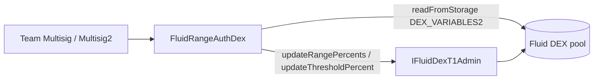

# Config / rangeAuthDex — SPEC

## 1. Purpose

Narrow, rate-limited multisig path for adjusting a Fluid DEX pool's **center-price range** (the upper / lower percentage boundaries of the concentrated-liquidity curve) and its **threshold config** (the inner percentage boundaries that trigger range rebalancing, plus the threshold shift time).

Exposes three setters that forward to the DEX admin module (`IFluidDexT1Admin.updateRangePercents` / `updateThresholdPercent`). Every call is:

- Gated to **MID-tier auths at `AUTH_GATE`** (MS2, MS1, the team timelock, governance),
- Capped at **±30% change per call** vs. the current stored value,
- Subject to a **1-day cooldown per (dex, update-type)** pair,
- Subject to a **shift-time sanity window** (2–12 days, with a mainnet carve-out for the wstETH/ETH and weETH/ETH DEXes which must use instant shift).

Single contract: `FluidRangeAuthDex` in `main.sol`. See also [`../SPEC.md`](../SPEC.md).

## 2. Architecture & Data Flow

Per call: `multisig → FluidRangeAuthDex` (auth + cooldown + shift-time + per-change cap checks, reading `dexVariables2` for the current config) → `IFluidDexT1Admin` on the target DEX → event emission.

## 3. External Interactions

- Must be registered as an **auth on each target DEX** (`IFluidDexT1Admin` calls revert otherwise).
- Reads a single slot per call: `DexSlotsLink.DEX_VARIABLES2_SLOT` via `IFluidDexT1.readFromStorage`, for the current range / threshold bits.
- Forwards to two DEX admin methods:
  - `updateRangePercents(upperPercent, lowerPercent, shiftTime)`
  - `updateThresholdPercent(upperThresholdPercent, lowerThresholdPercent, thresholdShiftTime, shiftTime)`
- Does not touch Liquidity, Vault factory, Smart lending, or Reserve.
- Holds no tokens, no native ETH, no callback surface.

## 4. Roles & Access Control

Single tier: **MID** and above at `AUTH_GATE`. Operator / rebalancer tiers are **not** used by this contract.

| Modifier | Who passes | Errors |
| --- | --- | --- |
| `onlyAuthLevelMid` | `AUTH_GATE.requireAuthLevelMid(sender)` — MID tier and above (MS2, MS1, the team timelock, governance) | `Access__Unauthorized` (from the auth gate) |
| `validAddress(value_)` | `value_ != 0` (shared `BasicValidations`) | `BasicValidations__AddressZero` |

Constants:

| Name | Value |
| --- | --- |
| `AUTH_GATE` | immutable, constructor-set — identity registry, see [../authGate/SPEC.md](../authGate/SPEC.md) |

Every MID-and-above identity has identical power here; there is no second-tier "unpause only" distinction.

## 5. Storage Layout

### Immutables (per-deploy)

| Name | Meaning |
| --- | --- |
| `WSTETH_ETH_DEX` | wstETH/ETH DEX on mainnet, forced to `shiftTime_ == 0`. |
| `WEETH_ETH_DEX` | weETH/ETH DEX on mainnet, forced to `shiftTime_ == 0`. |

Constructor reverts `100091` if `block.chainid == 1` and either address is zero (on non-mainnet deploys zero is permitted), or if the gate's `LIQUIDITY()` is zero.

### Constants

| Name | Value | Purpose |
| --- | --- | --- |
| `COOLDOWN` | `1 days` | Minimum wait between updates of the same type on the same DEX. |
| `MAX_PERCENT_RANGE_CHANGE_ALLOWED` | `30 * 1e4` (= `300_000`) | Maximum per-call percent delta in the internal 1e6-scaled space (≈ 30%). |
| `MIN_SHIFT_TIME` / `MAX_SHIFT_TIME` | `2 days` / `12 days` | Bounds for `shiftTime_` outside the wstETH/weETH carve-out. |
| `THREE_DECIMALS` | `1e3` | Threshold-percent scale multiplier (see §6.4). |
| `X10` / `X20` / `X24` | `0x3ff` / `0xfffff` / `0xffffff` | Bit masks for threshold / range / shift-time fields in `dexVariables2`. |

### Mappings

| Mapping | Type | Meaning |
| --- | --- | --- |
| `dexLastUpdateTimestamp` | `mapping(address => mapping(UpdateType => uint256))` | Last successful update timestamp per `(dex, RANGES \| THRESHOLD)`. Written before the external DEX call. |

`UpdateType` is an `enum { RANGES, THRESHOLD }`. The two types have **independent cooldown clocks** — a ranges update does not block a threshold update on the same DEX and vice versa.

## 6. Method Summary

### 6.1 Views

| Method | Returns | Source |
| --- | --- | --- |
| `getRanges(dex)` | `(upperRangePercent, lowerRangePercent)` in 4-decimal scale (`10_000 == 1%`) | `dexVariables2` bits `27..46` (upper) and `47..66` (lower), 20 bits each. |
| `getThresholdConfig(dex)` | `(upperThresholdPercent, lowerThresholdPercent, thresholdShiftTime)` | `dexVariables2` bits `68..77` (upper) and `78..87` (lower), 10 bits each, multiplied by `1e3` to restore 4-decimal scale; `thresholdShiftTime` from bits `88..111` (24 bits, seconds). |
| `dexLastUpdateTimestamp(dex, UpdateType)` | `uint256` | Cooldown bookkeeping. |

### 6.2 `setRanges(dex_, upperRangePercent_, lowerRangePercent_, shiftTime_)`

MID tier. Forwards to `IFluidDexT1Admin.updateRangePercents(upper, lower, shiftTime)` after:

1. `_validateLastUpdateTime(dex_, RANGES)` — revert `100092` if < 1 day since last ranges update.
2. `_validateShiftTime(dex_, shiftTime_)` — revert `100095` if out of bounds (see §6.5).
3. Read `(currentUpper, currentLower)` via `getRanges`; revert `100096` if both equal the new values.
4. `_validateChange(currentUpper, upperRangePercent_)` — revert `100094` if percent diff > 30% (see §7).
5. `_validateChange(currentLower, lowerRangePercent_)` — same.
6. Write `dexLastUpdateTimestamp[dex_][RANGES] = block.timestamp`.
7. Emit `LogSetRanges(dex, upperRangePercent, lowerRangePercent, shiftTime)`.

Values are passed straight through in 4-decimal scale.

### 6.3 `setRangesByPercentage(dex_, newUpperRangePercentage_, newLowerRangePercentage_, shiftTime_)`

MID tier, relative form. Accepts **signed** deltas (`10_000 == 1%`, positive = increase, negative = decrease) and computes the absolute targets from the current on-chain values.

1. Cooldown + shift-time checks (as §6.2).
2. `_validatePercentChange(|newUpperRangePercentage_|)` — revert `100094` if `|Δ|` > `30 * 1e4` in the 1e6-scaled space (i.e. > 30%).
3. Same for the lower delta.
4. `newUpper = _getNewRange(currentUpper, newUpperRangePercentage_)` → `current ± current * |Δ| / 1e6`.
5. Same for lower; revert `100096` if both equal the current values (e.g. a 0% delta, or one that rounds to 0).
6. Persist cooldown, call `updateRangePercents(newUpper, newLower, shiftTime_)`, emit `LogSetRanges` with the computed absolute values.

Note: this path caps the **relative** change directly and skips `_validateChange` on the absolute values (redundant, since the relative cap subsumes it).

### 6.4 `setThresholdConfig(dex_, upperThresholdPercent_, lowerThresholdPercent_, thresholdShiftTime_, shiftTime_)`

MID tier. Forwards to `IFluidDexT1Admin.updateThresholdPercent(upper, lower, thresholdShift, shiftTime)` after:

1. `_validateLastUpdateTime(dex_, THRESHOLD)` — 1-day cooldown on the THRESHOLD track.
2. `_validateShiftTime(dex_, shiftTime_)`.
3. Read `(currentUpperT, currentLowerT, currentThresholdShiftTime)` via `getThresholdConfig`; revert `100096` if all three are unchanged at the DEX's 0.1% threshold precision.
4. `_validateChange` against **each of the three** (upper threshold, lower threshold, threshold shift time) — any >30% move reverts `100094`, and so does any threshold write off `0` (see §11).
5. Persist cooldown, call the admin method, emit `LogSetThresholdConfig(dex, upper, lower, thresholdShift, shiftTime)`.

Threshold percents are stored on the DEX in a reduced 10-bit / 3-decimal form; this contract exposes and accepts them in the full 4-decimal scale (`10_000 == 1%`) and relies on the DEX admin module for the downcast.

### 6.5 `_validateShiftTime`

| Chain & DEX | Allowed `shiftTime_` | Error |
| --- | --- | --- |
| `chainid == 1` and `dex_ ∈ {WSTETH_ETH_DEX, WEETH_ETH_DEX}` | `0` only (instant shift) | `100095 RangeAuthDex__InvalidShiftTime` |
| Otherwise | `MIN_SHIFT_TIME ≤ shiftTime_ ≤ MAX_SHIFT_TIME` (2–12 days) | `100095` |

## 7. Caps, Cooldowns & Math

### Per-call cap

`_percentDiffForValue(oldValue, newValue)` computes the *symmetric* magnitude:

- Decrease: `(old - new) * 1e6 / old` (% by which `new` is smaller than `old`).
- Increase: `(new - old) * 1e6 / old` (% by which `new` is bigger than `old`, using the **old** value as the denominator — so a 10→8 move is 20% while an 8→10 move is 25%).
- `old == new` → returns `0`.
- `old == 0` with any other `new` → returns `type(uint256).max`, so the cap always rejects it (see §11).

`_validatePercentChange` then rejects anything `> MAX_PERCENT_RANGE_CHANGE_ALLOWED` (`300_000` in the 1e6 space, i.e. 30%).

`setRangesByPercentage` uses the same threshold but on the caller-supplied relative delta directly (`_validatePercentChange(|delta|)` pre-apply), and computes the absolute target with the same 1e6 denominator (`_getNewRange`).

### Cooldown

| Update type | Tracked in | Duration |
| --- | --- | --- |
| `RANGES` (setRanges / setRangesByPercentage) | `dexLastUpdateTimestamp[dex][RANGES]` | `1 day` |
| `THRESHOLD` (setThresholdConfig) | `dexLastUpdateTimestamp[dex][THRESHOLD]` | `1 day` |

Cooldown is enforced via `block.timestamp - last < COOLDOWN` → revert `100092`. First-ever update on a given DEX/type has `last == 0`, so it passes immediately.

Outside the carve-out every call also starts a 2–12-day DEX shift, which is the real cadence: a re-call after 1 day passes here but reverts at the DEX (`52004`) until the shift has ended and a pool operation has cleared it.

The cooldown timestamp is written **before** the DEX admin call. If the admin call reverts, the cooldown write is rolled back with it (tx revert).

## 8. Events & Errors

### Events

| Event | Emitted by | Params |
| --- | --- | --- |
| `LogSetRanges` | `setRanges`, `setRangesByPercentage` | `(dex, upperPercent, lowerPercent, shiftTime)` — absolute target values. |
| `LogSetThresholdConfig` | `setThresholdConfig` | `(dex, upperPercent, lowerPercent, thresholdShiftTime, shiftTime)` — raw 4-decimal inputs; the DEX stores the percents / 1e3, so its own `LogUpdateThresholdPercent` is authoritative. |

No skip / no-op events: every call that reaches the external admin call succeeded.

### Errors (all `FluidConfigError(errorId_)`)

| ID | Name | When |
| --- | --- | --- |
| 100091 | `RangeAuthDex__InvalidParams` | Constructor: mainnet with zero wstETH/weETH dex address, or a gate whose `LIQUIDITY()` is zero. A zero auth gate reverts the shared `BasicValidations__AddressZero`. |
| 100092 | `RangeAuthDex__CooldownLeft` | < 1 day since last update of the same type on this DEX. |
| — | `Access__Unauthorized` (from the auth gate) | Caller is below the MID tier at `AUTH_GATE`. Replaces the retired `100093 RangeAuthDex__Unauthorized` (still emitted by legacy deployed versions). |
| 100094 | `RangeAuthDex__ExceedAllowedPercentageChange` | Any single field moves by > 30% vs. current or off a current `0` (or the caller-supplied relative delta exceeds 30%). |
| 100095 | `RangeAuthDex__InvalidShiftTime` | `shiftTime_` outside 2–12 days, or non-zero on the mainnet wstETH/weETH dexes. |
| 100096 | `RangeAuthDex__NoChange` | The new ranges or threshold config equal the stored ones; reverts before the cooldown is stamped. |

## 9. DEX Admin Forwarding (cheatsheet)

| This contract | Forwards to | Signature |
| --- | --- | --- |
| `setRanges` / `setRangesByPercentage` | `IFluidDexT1Admin.updateRangePercents` | `(uint upperPercent, uint lowerPercent, uint shiftTime)` — all in 4-decimal scale except `shiftTime` (seconds). |
| `setThresholdConfig` | `IFluidDexT1Admin.updateThresholdPercent` | `(uint upperThresholdPercent, uint lowerThresholdPercent, uint thresholdShiftTime, uint shiftTime)` — first two in 4-decimal scale; both times in seconds. |

`upperPercent` / `lowerPercent` are the outer range of the concentrated-liquidity curve; the threshold percents are the inner margin inside which the pool does not re-centre. `thresholdShiftTime` controls how quickly the pool walks its ranges toward the new threshold when triggered; the `shiftTime` argument on `updateThresholdPercent` governs how quickly the *threshold percent change itself* phases in.

## 10. Deployment Checklist

1. Deploy `FluidRangeAuthDex(wstethEthDex_, weethEthDex_, authGate_)` — `authGate_` is the **proxy** address from [../authGate/SPEC.md](../authGate/SPEC.md) and rejects zero (`BasicValidations__AddressZero`).
   - On mainnet: both addresses must be non-zero (must point to the real wstETH/ETH and weETH/ETH DEXes).
   - On other chains: pass `address(0), address(0)` (permitted).
2. Register the deployed contract as an **auth** on each target DEX's admin module. Without this, every `updateRangePercents` / `updateThresholdPercent` call reverts at the DEX.
3. No further configuration is required; there is no allowlist mapping, no rebalancer list, no ownership transfer.

## 11. Invariants & Safety Notes

- **MID tier only.** There is no operator / rebalancer tier — ranges and thresholds are considered high-impact and go exclusively through MID-tier auths at `AUTH_GATE`.
- **Per-call 30% cap + 1-day cooldown** together bound the parameter drift reachable without governance intervention.
- **Cooldown is per (dex, type).** A compromised multisig cannot, within one tx, both move ranges 30% and thresholds 30% on the same DEX more than once per 1 day per track, but the two tracks are independent and can both be touched within the same calendar day (each track has its own timestamp).
- **Zero thresholds cannot be switched on here.** Thresholds of 0/0 are not unset: they are the designed steady state of pools priced by an external center price, with threshold rebalancing off. No relative cap is meaningful against 0, so a write off 0 reverts `100094` and turning rebalancing on is left to governance or a DEX auth. Switching off stays reachable: `getThresholdConfig` reports stored × 1e3 while the DEX stores input / 1e3, so a −30% write from 0.1% (`1000` → `700`) stores 0. Ranges and threshold shift times are never 0 (the DEX rejects both), so only thresholds reach this.
- **Ranges of 1–3 units cannot be changed here.** Any other value is more than 30% away, and `setRangesByPercentage` rounds the delta to 0, which reverts `100096`.
- **Signed-delta safety.** `setRangesByPercentage` takes `int256` and calls `_abs` before capping. `int256.min` would overflow `-value_` in Solidity 0.8, reverting; any value that passes `_abs` and the 30%-cap check is safe for the subsequent `_getNewRange` arithmetic, which uses `uint256(newRangePercentage_)` / `uint256(-newRangePercentage_)` explicitly. Negative deltas of magnitude ≥ 100% are implicitly rejected by the 30% cap.
- **No inversion check.** The contract does not enforce `upper > lower` or `upperThreshold < upperRange` etc. — those structural invariants are the DEX admin module's responsibility. This contract only checks *magnitude-of-change* vs. current.
- **Shift-time carve-out is mainnet-only.** The `block.chainid == 1 && dex ∈ {wstETH/ETH, weETH/ETH}` branch forces instant shifts for those two correlated-asset pairs; on testnets or other L2 deployments of the same DEXes the 2–12 day window applies.
- **Cooldown write precedes the admin call.** If the DEX admin call reverts, the whole tx reverts and the cooldown is rolled back; the multisig can retry in the same block after fixing params.
- **No funds / no reentrancy surface.** No token balances, no callbacks, no `rescueTokens` needed.

## 12. Trust Model & Audit Notes

- **Root of trust**: MID-tier auths at `AUTH_GATE` (MS2, MS1, the team timelock, governance; any one acts alone). A compromise of *any* of them allows full use of every method on this contract, bounded by the 30%-per-call cap and 1-day cooldown.
- **Intentional bounds.** The 30% cap and 1-day cooldown are explicitly calibrated so that, even in the worst case of a compromised multisig, ranges and thresholds cannot drift faster than governance can react. Removing or weakening these constants would require a redeploy; there is no setter.
- **`setRangesByPercentage` vs. `setRanges`.** Relative-form is a convenience and uses the **same** 30% cap (just applied pre-apply rather than on the absolute target), so neither path is more permissive than the other.
- **No-op writes revert** `RangeAuthDex__NoChange` (`100096`) before the cooldown is stamped, so re-submitting the current config cannot lock a track for a day.
- **Replacement path.** To adjust caps / cooldowns, deploy a new `FluidRangeAuthDex`, register it as auth on each DEX, and remove the old one in the same batch. There is no in-place upgrade; rotating a multisig is a gate upgrade.
- Cross-reference: see [`../SPEC.md`](../SPEC.md) §2 (index) and §3.2 (auth-contract pattern).
