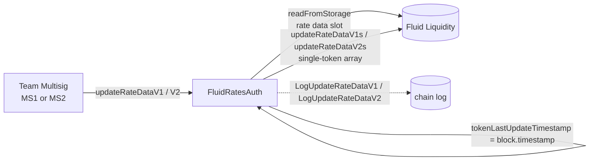

# Config / ratesAuth — SPEC

## 1. Purpose

Bounded team-multisig path to nudge the **borrow rate curve** of a token on Fluid Liquidity without opening the raw `updateRateDataV1s` / `updateRateDataV2s` admin surface. Operators pass the **full** `RateDataV1Params` / `RateDataV2Params` tuple (same shape as Liquidity admin). The auth builds an effective curve, then forwards a single-element array to Liquidity.

Caps and semantics:

- **Utilization kinks** (`kink` for V1; `kink1` / `kink2` for V2): absolute change per field may not exceed **`KINK_MAX_ABSOLUTE_DELTA = 1000`** on the same scale as Liquidity utilization (`10_000 == 100%` utilization). This is **10 percentage points** absolute, not a relative percent of the old kink.
- **All borrow rates** (`rateAtUtilizationZero`, `rateAtUtilizationKink*`, `rateAtUtilizationMax`): allowed `|Δ|` per update = `max(RATE_RELATIVE_MAX_DELTA relative, RATE_ABSOLUTE_MAX_DELTA absolute)`. `RATE_RELATIVE_MAX_DELTA = 3000` (30%) and `RATE_ABSOLUTE_MAX_DELTA = 100` (1% on the Liquidity borrow-rate scale where `100 == 1%`). The absolute floor kicks in when the old rate is small enough that the relative term falls below it. When `old == 0` the relative allowance is 0, so only the absolute floor applies. Calldata **`0` means "leave this field unchanged"** for every field **except** `rateAtUtilizationZero`.
- **`rateAtUtilizationZero`**: calldata **`0` is a real value** (minimum borrow rate at zero utilization). There is **no** "skip" sentinel for this field. All moves — including reductions to `0` — are subject to the same `max(relative, absolute)` cap as all other rates.
- **Cooldown**: one shared `COOLDOWN` (seconds) per token between any successful V1 or V2 update for that token.

Single contract, deployed per Liquidity instance:

| Contract | File | Role |
| --- | --- | --- |
| `FluidRatesAuth` | `main.sol` | Team-multisig-gated wrapper around Liquidity `updateRateDataV{1,2}s`. Enforces caps, skip-`0` coalescing (except at 0% util), and per-token cooldown. |

Cross-ref: [`../SPEC.md`](../SPEC.md) (config index, error convention, multisig constants).

## 2. Architecture & Data Flow

Per call: read slot → version + cooldown → coalesce `0` (except `rateAtUtilizationZero`) → revert if unchanged → validate kinks (absolute cap) and all borrow rates (`max(relative, absolute)` in both directions) → forward **resolved** struct → bump timestamp → emit.

## 3. External Interactions

- Registered as an **auth on Fluid Liquidity** — required for `updateRateDataV1s` / `updateRateDataV2s` (both `onlyAuths`).
- Reads the token's rate-data slot via `LIQUIDITY.readFromStorage(keccak256(token, LIQUIDITY_RATE_DATA_MAPPING_SLOT))` to learn the current curve and version.
- Does not read oracles, does not hold any balances, has no callbacks, emits no events on Liquidity beyond what Liquidity itself emits (`LogUpdateRateDataV1s` / `LogUpdateRateDataV2s`).
- Downstream Liquidity admin validates the final packed struct (rate ≤ `2^16-1`, `kink ∈ (0, 1e4)`, `kink1 < kink2 < 1e4`, `rateAtUtilizationKink{_,2} ≤ rateAtUtilizationMax`). Those revert at the Liquidity layer with `FluidLiquidityError(AdminModule__*)` — see §9.

## 4. Roles & Access Control

| Modifier | Who passes |
| --- | --- |
| `onlyAuthLevelMid` | `AUTH_GATE.requireAuthLevelMid(sender)` — MID tier and above (MS2, MS1, the team timelock, governance). Reverts the gate's `Access__Unauthorized`. |

There are **no per-operator roles, no allowlist, no class tiers, no per-token permission map**. Every MID-tier identity at the gate has identical, unrestricted rights over every token's curve (subject to the caps + cooldown). All setters revert the gate's `Access__Unauthorized` for any other caller; the old `RatesAuth__Unauthorized` (`100042`) is retired and is only still emitted by legacy deployed versions.

Hardcoded constants (from `Constants`):

- `AUTH_GATE` (immutable, constructor-set) — identity registry resolving the multisig tier, see [../authGate/SPEC.md](../authGate/SPEC.md).

## 5. Storage Layout

| Storage | Type | Meaning |
| --- | --- | --- |
| `tokenLastUpdateTimestamp` | `mapping(address => uint256)` | `block.timestamp` of the last successful `updateRateDataV{1,2}` for that token. Used for the cooldown check. |

Immutables (constructor):

| Immutable | Type | Constraint |
| --- | --- | --- |
| `LIQUIDITY` | `IFluidLiquidity` | `!= address(0)` else `BasicValidations__AddressZero` (`72001`). |
| `AUTH_GATE` | `IFluidAuthGate` | `!= address(0)` else `BasicValidations__AddressZero` (`72001`). Identity registry — see [../authGate/SPEC.md](../authGate/SPEC.md). |

Constants (hardcoded):

| Constant | Value | Meaning |
| --- | --- | --- |
| `RATE_RELATIVE_MAX_DELTA` | `3000` | 30% relative cap per borrow-rate update (1e4 scale). |
| `COOLDOWN` | `1 days` | Minimum seconds between updates for the same token. |
| `KINK_MAX_ABSOLUTE_DELTA` | `1000` | Max absolute utilization delta per kink field per update (10 pp). |
| `RATE_ABSOLUTE_MAX_DELTA` | `100` | 1% APR absolute floor; effective cap = `max(relative, absolute)`. |

## 6. Input Shape

Inputs are **`AdminModuleStructs.RateDataV1Params`** and **`AdminModuleStructs.RateDataV2Params`** (see `contracts/liquidity/adminModule/structs.sol`) — the same structs Liquidity admin uses.

**Sentinel `0` (skip unchanged):** for every field **except** `rateAtUtilizationZero`, if the calldata value is `0`, the contract substitutes the **current stored** value for that field before validation and before calling Liquidity. For `rateAtUtilizationZero`, `0` is always interpreted as the literal rate. So a struct with every rate and kink `0` is not a no-op: it sets a stored base rate of 1–100 (≤ 1%) to 0 and reverts `100041` above that.

Rates are in 4-decimal scale (`10_000 == 100%`, `100 == 1%`) for borrow rate points. Liquidity packs each into 16 bits and may revert on overflow or invalid curve — `FluidRatesAuth` does not duplicate those checks beyond its own caps.

## 7. Methods

### 7.1 `updateRateDataV1(RateDataV1Params calldata rateStruct_) external onlyAuthLevelMid`

1. Read packed rate slot; require version **1** else `RatesAuth__InvalidVersion` (`100045`).
2. Cooldown else `RatesAuth__CooldownLeft` (`100044`).
3. Build `out` in memory: `token` from calldata; `kink`, `rateAtUtilizationKink`, `rateAtUtilizationMax` coalesced (calldata `0` → old value); `rateAtUtilizationZero` from calldata unchanged. If `out` equals the stored curve, revert `RatesAuth__NoChange` (`100046`).
4. `_requireKinkAbsoluteDelta(oldKink, out.kink)` else `RatesAuth__AllowedDeltaExceeded` (`100041`).
5. `_requireBorrowRateDelta(oldZero, out.rateAtUtilizationZero)` → may `RatesAuth__AllowedDeltaExceeded` (`100041`).
6. `_requireBorrowRateDelta(oldKinkRate, out.rateAtUtilizationKink)` → may `RatesAuth__AllowedDeltaExceeded` (`100041`).
7. Same for `rateAtUtilizationMax`.
8. `LIQUIDITY.updateRateDataV1s([out])`; bump timestamp; emit `LogUpdateRateDataV1`.

### 7.2 `updateRateDataV2(RateDataV2Params calldata rateStruct_) external onlyAuthLevelMid`

Same pattern: version **2**; coalesce all fields except `rateAtUtilizationZero`; `RatesAuth__NoChange` if the result equals the stored curve; `_requireKinkAbsoluteDelta` on `kink1` / `kink2`; then `_requireBorrowRateDelta` on all rates including `rateAtUtilizationZero`, `rateAtUtilizationKink1`, `rateAtUtilizationKink2`, `rateAtUtilizationMax`; emit `LogUpdateRateDataV2`.

### 7.3 Bit layout (reference)

| Field | V1 shift | V2 shift |
| --- | --- | --- |
| version (low nibble) | `0..3` | `0..3` |
| `rateAtUtilizationZero` | `4..19` | `4..19` |
| `kink` / `kink1` | `20..35` | `20..35` |
| `rateAtUtilizationKink` / `Kink1` | `36..51` | `36..51` |
| `rateAtUtilizationMax` / `kink2` | `52..67` | `52..67` |
| `rateAtUtilizationKink2` | — | `68..83` |
| `rateAtUtilizationMax` (V2) | — | `84..99` |

(From `LiquiditySlotsLink`. The V2 `kink2` intentionally reuses the V1 `rateAtUtilizationMax` position; that is why the version gate matters.)

## 8. Helpers

### `_absoluteDiff(a, b)`

Returns `|a - b|` in an `unchecked` block (safe because the ternary always subtracts the smaller from the larger).

### `_relativeDiff(old, new)`

Returns `(_absoluteDiff(old, new) * 1e4) / old`. Returns `type(uint256).max` when `old == 0` so the relative leg of the cap is always considered exceeded and only the absolute cap governs. The division floors to whole bps, so any relative change below 30.01% passes the 30% leg.

### `_requireKinkAbsoluteDelta(old, new)`

Reverts `RatesAuth__AllowedDeltaExceeded` if `_absoluteDiff(old, new) > KINK_MAX_ABSOLUTE_DELTA`.

### `_requireBorrowRateDelta(old, new)`

No-op if `old == new`. Reverts `RatesAuth__AllowedDeltaExceeded` when **both**:
- `_absoluteDiff(old, new) > RATE_ABSOLUTE_MAX_DELTA`, **and**
- `_relativeDiff(old, new) > RATE_RELATIVE_MAX_DELTA`

This is equivalent to `|Δ| > max(RATE_RELATIVE_MAX_DELTA relative, RATE_ABSOLUTE_MAX_DELTA absolute)` — the change must exceed the larger of the two caps to revert.

## 9. Errors

All raised as `FluidConfigError(errorId)` from `contracts/config/error.sol`.

| Code | Name | When |
| --- | --- | --- |
| 100041 | `RatesAuth__AllowedDeltaExceeded` | Kink absolute delta over cap, or any borrow rate move (in either direction, including moves to `0`) where `|Δ| > max(RATE_RELATIVE_MAX_DELTA relative, RATE_ABSOLUTE_MAX_DELTA absolute)`. |
| — | `Access__Unauthorized` (from the auth gate) | Caller is below the MID tier at `AUTH_GATE`. Replaces the retired `100042 RatesAuth__Unauthorized` (still emitted by legacy deployed versions). |
| 100043 | `RatesAuth__InvalidParams` | Constructor: the gate's `LIQUIDITY()` differs from `liquidity`. Zero addresses revert the shared `BasicValidations__AddressZero` (`72001`). |
| 100044 | `RatesAuth__CooldownLeft` | `block.timestamp - tokenLastUpdateTimestamp[token] < COOLDOWN`. |
| 100045 | `RatesAuth__InvalidVersion` | V1 method on V2 data or vice versa. |
| 100046 | `RatesAuth__NoChange` | The resolved struct equals the stored curve. |

Downstream Liquidity errors unchanged — see prior SPEC revision for `AdminModule__*`.

See `../SPEC.md` §3.4 for the error ID allocation table (`ratesAuth` range is **`100041–100046`**).

## 10. Deployment Checklist

1. Deploy `FluidRatesAuth(liquidity, authGate)` — `authGate` is the **proxy** address from [../authGate/SPEC.md](../authGate/SPEC.md); both args reject zero.
2. Governance registers the deployed address as an **auth** on Fluid Liquidity and removes the previous `FluidRatesAuth` in the same batch.
3. Operators encoding txs must use the skip-`0` convention for unchanged non-`rateAtUtilizationZero` fields.

## 11. Invariants & Safety Notes

- **Skip-`0` on uninitialized tokens:** the version gate requires existing packed rate data for the token; Liquidity enforces listing / curve validity on update.
- **Cooldown** is per-token and shared across all fields and V1/V2.
- **Kink absolute cap** is not constructor-configurable.
- **Caps are per field, not on the live rate.** Combining kink moves with rate moves can shift the live borrow rate far more than 30% in one call.
- **A no-op update reverts.** If the resolved struct equals the stored curve the call reverts `RatesAuth__NoChange` (`100046`), so resubmitting the current curve cannot burn the shared cooldown.

## 12. Trust Model & Audit Notes

- **Root of trust**: MID-tier auths at `AUTH_GATE` (MS2, MS1, the team timelock, governance). Unauthorized calls revert with the gate's `Access__Unauthorized`, not a config error ID.
- **Constructor** only sets `LIQUIDITY` and `AUTH_GATE`, rejecting a gate bound to another Liquidity; all caps and cooldown are hardcoded constants.
