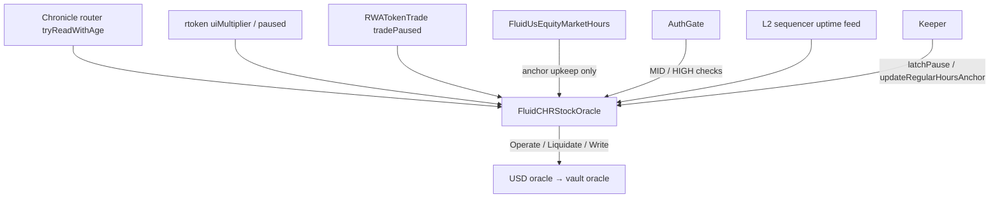

# Chronicle × Reality Stock Oracle — SPEC

Chronicle equity price × Reality rtoken `uiMultiplier`, with a stored regular-session anchor, a cap and a break
around it, a multiplier freeze, and a pause that anyone can latch while the issuer has halted the token or changed
its multiplier.

Sources: [`main.sol`](./main.sol), [`mainL2.sol`](./mainL2.sol), [`helpers.sol`](./helpers.sol), [`variables.sol`](./variables.sol),
[`structs.sol`](./structs.sol), [`events.sol`](./events.sol),
[`../interfaces/iFluidCHRStockOracle.sol`](../interfaces/iFluidCHRStockOracle.sol),
[`../interfaces/external/`](../interfaces/external/) (`IChronicle`, `IRealityToken`, `IRealityTokenTrade`),
[`../../common/sequencerL2.sol`](../../common/sequencerL2.sol). Walkthroughs and accepted residuals:
[`EDGE_CASES.md`](./EDGE_CASES.md). Market hours: [`../usEquityMarketHours/SPEC.md`](../usEquityMarketHours/SPEC.md).
Sibling design: [`../clxStockOracle/SPEC.md`](../clxStockOracle/SPEC.md).

## 1. Purpose

```
liveValue = price × liveMultiplier / PRICE_TIMES_MULTIPLIER_TO_RATE
```

`price` is Chronicle's value (18 decimals) and `liveMultiplier` the rtoken's `uiMultiplier()` (1e18 = 1×), so their
product has 36 decimals; dividing by the constant `PRICE_TIMES_MULTIPLIER_TO_RATE = 1e9` gives Fluid's **1e27**,
rounded down. The price and multiplier bounds (§4 steps 5–6) keep the product below `2^256`. One oracle per rtoken, consumed as
a `SOURCE_FLUID_ORACLE` source by the USD oracle (`targetDecimals` fixed at 27). Not upgradeable. `FluidCHRStockOracle` (`main.sol`) has no sequencer check;
`FluidCHRStockOracleL2` (`mainL2.sol`) adds it and is the one to deploy on L2s (§5).

**Price inputs.** Chronicle posts the plain stock price, no splits or dividends applied: exchange data during the
regular session, a Hyperliquid perp outside it, around the clock. Reality applies splits to the rtoken through
`uiMultiplier` (ERC-8056, Reality's rtoken standard); dividends are claimed separately and are not part of the value.

**Main hazard.** A split moves its two legs, the Chronicle price and the multiplier, at independent moments. If one
moves without the other, the value is off by the split ratio (2:1 → −50% / +100%). The guards below keep that
desync away from operate and liquidate, with the residuals listed in
[EDGE_CASES §15](./EDGE_CASES.md#15-accepted-residuals). "Price-first" means Chronicle reprices before Reality moves
the multiplier.

## 2. Assumptions & trust

1. **Chronicle is trusted less than a Chainlink 24/5 feed.** It has no on-chain history, and off-hours it is a single
   venue. Hence a cap in every session, including the regular one.
2. **Reality flags are authoritative halts.** "Reality flags" are `tradePaused(rtoken)` on `RWATokenTrade` and rtoken
   `paused()`. Either of them stops every guarded read, liquidations
   included: a liquidation at a desynced price cannot be undone. Reality sets `tradePaused` while it processes a
   corporate action and clears it when its own steps are done, which can be before Chronicle has repriced.
3. **Chronicle's own corporate-action pause is best effort.** Chronicle stops posting around corporate-action dates;
   on-chain that is only missing prints (`StalePrice`). The oracle does not rely on it.
4. **Every multiplier change is a corporate action.** Reality has no continuous multiplier drift and no on-chain
   schedule (`effectiveAt` is the execution time), so the multiplier is frozen: any change needs HIGH `setAnchor`
   (§6). `newUIMultiplier()` and `effectiveAt()` are ignored; advance scheduling would need a redesign.
5. **Operators act.** HIGH (§9) checks both legs before `setAnchor`. On any break, an operator acts before the
   anchor ages out, `ANCHOR_MAX_AGE` (5 days 12 hours) after the anchor's print, not after the break: about 1 day 18
   hours for a split on the first session after a 3-day weekend. MID `pause()` if the multiplier has not moved yet,
   HIGH `setAnchor` and MID `unpause()` once it has.
6. **Chronicle read access is allowlisted per address ("toll").** Until the oracle's address is tolled, and whenever
   Chronicle revokes it, every Chronicle read reverts with Chronicle's error, and so does every getter that reads
   Chronicle. The constructor therefore never reads Chronicle.
7. **Distribution-based corporate actions** (extra tokens instead of a multiplier change) are out of scope.

## 3. Architecture



| Dependency | Call | When |
| --- | --- | --- |
| Chronicle router | `tryReadWithAge() returns (bool ok, uint256 value, uint256 age)`; `age` is the Unix timestamp of the print | every price getter and `updateRegularHoursAnchor` |
| rtoken | `uiMultiplier()`, `paused()` | guarded reads, latch, `unpause`, `setAnchor`, `updateRegularHoursAnchor`; `uiMultiplier()` also in the `*Raw` getters, `getExchangeRate()` and the constructor |
| Reality `RWATokenTrade` (`IRealityTokenTrade`) | `tradePaused(address) returns (bool)` | guarded reads, latch, `unpause`, `setAnchor`, `updateRegularHoursAnchor`; constructor (probe) |
| Market hours (MH, `IFluidUsEquityMarketHours`) | `getCurrentSession()`: session type and the latest REGULAR window that has started (the current one during a session, the last one outside it); advances the schedule cursor | write getters and `updateRegularHoursAnchor` (plain call, as in CLX) |
| Market hours | `getSessionInfo(block.timestamp)` (view) | constructor |
| AuthGate | `IFluidAuthGate.requireAuthLevelMid / High(sender)`; `IFluidAuthGateLiquidity.LIQUIDITY()` | admin calls; constructor |
| L2 sequencer uptime feed | `latestRoundData()`, `getRoundData()` | §5 |

View getters never call MH. If MH reverts, the write getters and `updateRegularHoursAnchor` revert too (as in CLX);
the USD oracle then falls back to the view getters, so pricing continues and only anchor upkeep stops (§7).

## 4. Read path

"Guarded reads" are `getExchangeRateOperate`, `getExchangeRateLiquidate`, `getExchangeRateOperateDebt`,
`getExchangeRateLiquidateDebt` and their four `*Write` variants. They run these steps in order; the first failing
one reverts with its own error (§12). "Anchor" is the effective anchor (§7).

| # | Check | Revert |
| --- | --- | --- |
| 1 | L2 variant only: sequencer down, or up for less than its grace period (§5) | `OracleV2CommonError` `SequencerL2__SequencerDown` / `SequencerL2__GracePeriod` |
| 2 | `_paused != 0` | `Paused` |
| 3 | rtoken `paused()` | `RtokenPaused` |
| 4 | `tradePaused(rtoken)` | `TradePaused` |
| 5 | `liveMultiplier != acceptedMultiplier`, a zero or oversized multiplier included (the accepted one is always valid) | `MultiplierChanged` |
| 6 | Chronicle `ok == false`, `price == 0`, `price > type(uint128).max`, `age == 0`, `age > block.timestamp`, or `liveValue == 0` | `InvalidPrice` |
| 7 | `liveValue` beyond the break of the anchor (skipped while no anchor is set or it is aged out, §7) | `PriceBreak` |
| 8 | `block.timestamp − age > maxOperateAge` (operate) / `> maxLiquidateAge` (liquidate) | `StalePrice` |
| 9 | `liveValue` outside the cap of the anchor (skipped like step 7): operate reverts, liquidate clamps | `OutsideCap` (operate) |

The bounds of steps 5–6 give `price × liveMultiplier < 2^128 × 2^104 ≈ 6.9e69`, far below `2^256`. External calls on the
read path that revert bubble up: a broken dependency fails closed.

**Cap and break bounds** (immutables on the 1e4 scale, `100% = 10_000`; each `delta` rounds down):

```
capDelta   = anchor × MAX_CAP_PERCENT / 1e4
capFloor   = anchor − capDelta            capCeiling = anchor + capDelta
beyond break: DeviationHelpers.isOutsideDeviation(anchor, liveValue, MAX_BREAK_PERCENT, 1e4)   (strict, either
              direction)
outside cap : liveValue < capFloor or liveValue > capCeiling
```

**Step 9, outside the cap:**

| Side | Operate | Liquidate |
| --- | --- | --- |
| Collateral (`getExchangeRateOperate` / `getExchangeRateLiquidate`) | revert `OutsideCap` | below `capFloor`: `capFloor`; above `capCeiling`: `liveValue` |
| Debt (`getExchangeRateOperateDebt` / `getExchangeRateLiquidateDebt`) | revert `OutsideCap` | above `capCeiling`: `capCeiling`; below `capFloor`: `liveValue` |

A liquidation never sees collateral below `capFloor` or debt above `capCeiling`, and is never clamped against the
user. This is CLX's directional clamp (`isOperate != isDebt` caps up, otherwise floors down) applied to liquidate.

**`*Raw` getters** (`getExchangeRateOperateRaw`, `getExchangeRateLiquidateRaw`, `getExchangeRateRaw`) skip every
check, the L2 sequencer gate included (as on the other L2 oracles), and answer while paused; `0` if step 6 fails or the live multiplier is 0 or above `uint104`.
`getExchangeRateOperateRaw` returns `min(liveValue, capCeiling)`, `getExchangeRateLiquidateRaw` returns
`max(liveValue, capFloor)`; neither clamps without an anchor or with an aged-out one. After a multiplier change and before
`setAnchor`, the live value uses the new multiplier while the cap bounds are still in the accepted multiplier's units, so
a directional raw clamp during that window is not a meaningful price. `getExchangeRateRaw` returns
`liveValue`. No debt `*Raw` getters (as in CLX). A dependency call that reverts (Chronicle without a toll, a broken
rtoken) reverts them too.

**`getExchangeRate()`** is the `IFluidOracle` rate, as on `FluidCappedRateL2`: the guarded-read hook (the sequencer
gate in the L2 variant, nothing in the base), then `getExchangeRateRaw()`, i.e. `liveValue` with no other check and no
clamp (`0` if step 6 fails or the live multiplier is 0 or above `uint104`). The USD oracle's `getPriceRawForMode` /
`getPricesRawForMode` (limit handlers, auth contracts) and the resolvers read it; vault oracles' raw path goes through
the USD oracle's guarded directional reads instead.

## 5. Sequencer (L2 variant)

Both contracts call the hook `_beforeGuardedPriceRead()` (same name as the USD oracle's) at the start of every guarded
read, `getExchangeRate()` and `updateRegularHoursAnchor()`. In `FluidCHRStockOracle` it is an empty virtual function.
`FluidCHRStockOracleL2 is FluidCHRStockOracle, FluidSequencerL2` overrides it with `_ensureSequencerUpAndValid()`,
takes the sequencer uptime feed as a second constructor argument (the helper rejects one without code), and adds
`sequencerL2Data()`. That override and the constructor are the whole difference between the two.

Same gate as the other OracleV2 L2 contracts: `FluidCenterPriceL2` (and through it every L2 capped rate) and
`FluidUsdOracleL2` all inherit `abstract contract FluidSequencerL2` in
[`../../common/sequencerL2.sol`](../../common/sequencerL2.sol) (`pragma >=0.8.21 <=0.8.36`; imports only
`IChainlinkAggregatorV3` and the OracleV2 common errors). It holds the algorithm and its two errors once
(`OracleV2CommonError` `SequencerL2__SequencerDown` 310205, `SequencerL2__GracePeriod` 310206) plus the constructor's
feed check (`SequencerL2__InvalidFeed` 310207, a feed without code), so every L2 oracle reverts the same way.
`sequencerL2Differential.t.sol` pins it to the pre-extraction copy kept in `oracleV1_DEPRECATED`.

```solidity
abstract contract FluidSequencerL2 is Error /* OracleV2 common */ {
    IChainlinkAggregatorV3 internal immutable _SEQUENCER_ORACLE;
    uint256 internal constant _SEQUENCER_MAX_GRACE_PERIOD = 45 minutes;
    constructor(address sequencerUptimeFeed_); // reverts SequencerL2__InvalidFeed if the feed has no code
    function sequencerL2Data() public view returns (address, uint256, bool, uint256, uint256, bool, uint256, bool);
    function _ensureSequencerUpAndValid() internal view; // reverts the two SequencerL2__ errors
}
```

`sequencerL2Data()` returns the same 8-tuple as before the extraction (feed, max grace, up, uptime start, grace,
grace passed, last outage start, up-and-valid). Semantics copied 1:1: feed `answer != 0` is down; consecutive up
rounds merge into one uptime; grace = outage duration capped at 45 minutes; passed iff `now − uptimeStart > grace`;
`startedAt == 0` is up with grace passed.

Gated: guarded reads, `getExchangeRate()` and `updateRegularHoursAnchor()`. Not gated: `*Raw` getters, admin calls,
`getConfig`, `sequencerL2Data`, and `latchPause()`, which must not revert and reads issuer state that is
correct whatever the sequencer did.

## 6. Multiplier freeze

`acceptedMultiplier` is set to `uiMultiplier()` at deploy. Any difference reverts guarded reads (step 5). There is
no band, no in-band sync and no separate confirm: HIGH `setAnchor(expectedMultiplier)` (§7) accepts the new
multiplier and the current price together. Before calling it after a split, the operator checks that Chronicle has
repriced (`liveValue` with the new multiplier ≈ the anchor); the oracle does not check continuity.

## 7. Anchor

The cap and break are measured from the value at the last regular-session print: during a session, the previous
session's; after `regularEnd` until the next open, that session's. Chronicle keeps no history, so the oracle stores
two parts:

- **Hint** — the latest in-session print seen so far: `(_hintValue, _hintAge, _hintRegularEnd)`; present iff
  `_hintAge != 0`; clearing zeroes all three.
- **Anchor** — the sealed value: `(_anchorValue, _anchorTime)`; set iff `_anchorTime != 0`. `_anchorTime` is always the
  timestamp of the print the value came from.

**Recording a hint.** Write getters (after their guarded read succeeded) and the permissionless
`updateRegularHoursAnchor()` record the current Chronicle print as the hint when all hold:

1. not paused, no Reality flag, `liveMultiplier == acceptedMultiplier`, Chronicle valid (step 6; staleness is not
   checked here, condition 4 bounds the print instead), `liveValue ≤ type(uint128).max`;
2. `liveValue` is inside the break of the anchor, unless no anchor is set yet or it is aged out;
3. `0 < regularStart ≤ regularEnd` in the MH answer;
4. `regularStart ≤ age ≤ regularEnd + REGULAR_HOURS_ANCHOR_BUFFER` (2 minutes, as CLX): the print is from the regular
   session, including the close, which typically lands within 2 minutes after the bell;
5. `age > _hintAge` and `age > _anchorTime`.

Write getters call MH on every call (it also advances the schedule cursor) and return the value their guarded read
computed, before any seal or record.

**Sealing.** A hint is sealable once its session and the buffer are over
(`block.timestamp > _hintRegularEnd + REGULAR_HOURS_ANCHOR_BUFFER`), so a close that lands within the buffer can still
replace an earlier print. Sealing writes
`_anchorValue = _hintValue`, `_anchorTime = _hintAge`, clears the hint and emits `LogSealAnchor`. Each write getter and
`updateRegularHoursAnchor()` seals a sealable hint, records the current print if it qualifies (`LogRecordHint`), then
seals again if that hint is sealable. Sealing never needs MH. A call after `regularEnd + REGULAR_HOURS_ANCHOR_BUFFER`
therefore records the last in-session print it can see and seals it in the same transaction, and one session's hint is never replaced by
the next session's print. View getters do not wait for a stored seal: the **effective anchor** is the sealable hint
if there is one, else the stored anchor. A hint was inside the break when recorded, so a seal moves the anchor by at
most one break (any amount after age-out).

**What the anchor tracks.** The last in-session print a call observed, not necessarily the official close. A keeper
calls `updateRegularHoursAnchor()` three times per session, timed from MH's `regularEnd` (half days and DST need no
special case):

| When | Why |
| --- | --- |
| `regularEnd − 10 min` | Fallback hint. If no later print qualifies, this one seals |
| `regularEnd + 1.5 min` | Catches a close stamped in the buffer before a later poke hides it |
| `regularEnd + 3 min` | Records the close if still visible, then seals |

Chronicle re-posts at least every ~30 minutes with a fresh `age` even when the value is unchanged, and posts sooner on
a move of 0.15% or more, so the close stays readable only until its next poke. If the last call lands late (e.g. the
sequencer grace period), nothing is lost: a sealable hint is the effective anchor and the next write stores it.
Residual: a Hyperliquid print stamped inside the buffer would also qualify, as an after-hours print does for CLX. A session nobody records is skipped, and cap and
break stay measured from the older anchor.

**No anchor and age-out (fail-open, as in CLX).** The anchor is unarmed while none is set yet (`anchorTime == 0`: a
fresh deployment until its first regular-session close is sealed) and when the effective anchor is aged out,
`block.timestamp − anchorTime > ANCHOR_MAX_AGE` (5 days 12 hours: close to next close across a 4-day closure, since
the cap also applies during the next session, unlike CLX's 5 days to the next open). Then steps 7 and 9 do not apply,
reads price live, and hints record without the break check, so the next seal arms both. No admin call is needed
after deployment. MH or a keeper failure
therefore never stops pricing; CLX's price-gap reference ages out the same way. The multiplier freeze, Reality flags
and staleness stay in force.

**`setAnchor(uint256 expectedMultiplier)`** (HIGH) accepts the current state. Checks, in order:

| # | Check | Revert |
| --- | --- | --- |
| 1 | caller is HIGH | AuthGate `Access__Unauthorized` |
| 2 | Reality flags, as §4 steps 3–4 | `RtokenPaused` / `TradePaused` |
| 3 | `uiMultiplier() == expectedMultiplier`, `0 < expectedMultiplier ≤ type(uint104).max` | `InvalidParams` |
| 4 | Chronicle valid (§4 step 6, using `expectedMultiplier`), `liveValue ≤ type(uint128).max` | `InvalidPrice` |
| 5 | `block.timestamp − age > maxOperateAge` | `StalePrice` |

Allowed while paused. Effects: `_anchorValue = liveValue`, `_anchorTime = age`, `_acceptedMultiplier =
expectedMultiplier`, hint cleared (a pending hint, sealable or not, is dropped), then
`LogSetAnchor(oldValue, newValue, oldMultiplier, newMultiplier)` with the previously stored `_anchorValue` and
`_acceptedMultiplier`. Uses: accepting a multiplier change and accepting a move beyond the break. The first anchor needs
no call: it is the first sealed regular-session close.

## 8. Pause and latch

Every admin call checks auth first. A call that would not change state returns early without an event (CLX pattern).

| Method | Auth | Effect |
| --- | --- | --- |
| `pause()` | MID | `_paused = 1`, `LogPause(sender)` |
| `unpause()` | MID | returns if not paused; reads the latch causes with plain calls (a reverting read reverts the unpause); reverts `LatchCauseActive` if one holds; else `_paused = 0`, `LogUnpause(sender)` |
| `latchPause() returns (uint256 causes)` | anyone | does not revert when a dependency reverts: each cause is read in try/catch, and a reverting read is not a cause (malformed return data still reverts it); if a cause holds and not yet paused, sets `_paused = 1` and emits `LogPauseLatched(causes)` |

**Latch causes** (bitmask): `1` `tradePaused(rtoken)`, `2` rtoken `paused()`, `4` `uiMultiplier() !=
acceptedMultiplier`. All three are issuer actions. Staleness and the break never latch: they
revert reads without storing anything and heal by themselves, so nobody can stop liquidations by calling
`latchPause()` at a threshold.

Guarded reads already revert while a cause holds, but a reverting read cannot store anything. The latch is the only
way an issuer event leaves a mark in this oracle's storage: once latched, pricing stays off until an operator has
reviewed it, even if the flag clears or the multiplier changes back. Before `unpause()` the operator checks that
Chronicle has repriced, the multiplier is accepted (HIGH `setAnchor` if it moved) and `liveValue` is near the
anchor. A keeper calls `latchPause()` every few minutes; an event that starts and ends between two calls leaves no
mark.

**Delisting.** The rtoken's `isDelisted()` is not read. A delisting is announced by Reality and watched by off-chain
monitoring; an operator pauses the oracle by hand. Once the stock stops trading, Chronicle stops posting and reads
revert `StalePrice` anyway.

**Two pause levers.** This oracle's `_paused` stops every guarded read of this rtoken, liquidations included; the
latch sets it, and [PauseAuth](../../../config/pauseAuth/SPEC.md) does not reach it. The USD oracle's per-token
operate pause (driven by PauseAuth) stops new risk while liquidations continue. Use the USD-oracle lever for "no new
borrows", this one for "the price is not trustworthy".

## 9. Roles

AuthGate tiers ([SPEC](../../../config/authGate/SPEC.md)): **MID** is the secondary team multisig and above, **HIGH**
the main team multisig and above; governance is the top tier.

| Tier | Powers |
| --- | --- |
| MID and above | `pause`, `unpause` |
| HIGH and above | `setAnchor`, plus MID powers |
| Anyone | getters, `latchPause`, `updateRegularHoursAnchor` |

Rotating a multisig is an AuthGate upgrade; the oracle binds the AuthGate proxy.

## 10. Constructor and deployment

Params struct `CHRStockOracleConstructorParams` (avoids stack-too-deep, as in CLX): `infoName`, `targetDecimals`
(27), `chronicle`, `rtoken`, `realityTokenTrade`, `marketHours`, `authGate`, `maxCapPercent`,
`maxBreakPercent`, `maxOperateAge`, `maxLiquidateAge`. Each becomes an immutable with the
UPPER_CASE name (`MAX_CAP_PERCENT`, …, `CHRONICLE`, `RTOKEN`, …). `FluidCHRStockOracleL2` takes the sequencer uptime
feed as a second argument.

Base constructors revert first: `FluidOracle` rejects `targetDecimals != 27` with `OracleV2CommonError(310204)` and an
invalid `infoName` length with `StringBytes32Utils`' error. Then `InvalidParams` unless:

- every address has code (`code.length > 0`);
- `IFluidAuthGateLiquidity(authGate).LIQUIDITY() != address(0)`;
- `0 < rtoken.uiMultiplier() ≤ type(uint104).max` (a wrong address reverts or fails this; a bad deploy is redeployed);
- `0 < maxCapPercent < maxBreakPercent < 10_000`;
- `0 < maxOperateAge ≤ maxLiquidateAge ≤ MAX_PRICE_AGE` (5 days).

`realityTokenTrade.tradePaused(rtoken)` and `marketHours.getSessionInfo(block.timestamp)` are called once as probes; a
revert bubbles. Chronicle is not read. `acceptedMultiplier = uiMultiplier()`; no anchor.

**Sizing (index ETFs: SPY, QQQ).** Cap 15% (`1_500`) bounds how far a misbehaving print can move liquidations.
Break ±30% (`3_000`, one value for both directions) catches every 2:1 desync (−50% / +100%), and a 3:2 one: price
first (−33.3%) unless a concurrent rise of more than about 5% hides it, multiplier first (+50%) unless a concurrent
drop of more than about 13% does. An index ETF moving 30% in a day is outside
any recorded session; single stocks do on earnings, so they need a wider break and a wider cap (otherwise one earnings gap blocks
borrowing and withdrawals for a whole session and holds liquidations at the cap). A move beyond the break halts
pricing until HIGH `setAnchor`, unless the session recorded a print inside the break first: that print seals at
`regularEnd + 2 minutes` and pricing resumes against it, so one close can absorb up to two breaks (−51% / +69% at
30%). A split desync is one jump with no print in between, so it still halts.

**Vault parameters.** Outside the cap, liquidations price collateral at `capFloor`, above market: when the real price
sits between cap and break, liquidating can be a loss for the liquidator and bad debt can grow until a print in that
range seals or the price recovers. List a vault only if `MAX_CAP_PERCENT ≤ liquidationMaxLimit − liquidationThreshold`
(both on the 1e4 scale).

**Order.** Deploy (`FluidCHRStockOracleL2` on L2s) → Chronicle tolls the address → register the USD-oracle key (it
needs `getExchangeRateOperate` and `getExchangeRateOperateDebt` to answer: with no anchor yet they price live) →
register the vault. Until the first regular-session close is sealed (at most about one trading day, with the keeper
running), cap and break are off; the multiplier freeze, Reality flags, latch and staleness apply from the start. A
redeploy starts with no anchor and needs a new toll.

## 11. API

`IFluidCHRStockOracle is IFluidOracleWithDebt, IFluidOracleWrite`; the contract also inherits `FluidOracle`. The L2
variant adds `FluidSequencerL2` (`sequencerL2Data()`).

| Method | Auth | Notes |
| --- | --- | --- |
| `infoName()` / `targetDecimals()` | view | from `FluidOracle` |
| `getExchangeRateOperate` / `getExchangeRateLiquidate` | view | collateral, §4 |
| `getExchangeRateOperateDebt` / `getExchangeRateLiquidateDebt` | view | debt, §4 |
| `getExchangeRate*Write` (4) | anyone | same read, then the §7 seal / record steps |
| `getExchangeRateOperateRaw` / `getExchangeRateLiquidateRaw` / `getExchangeRateRaw` | view | no checks, §4 |
| `getExchangeRate` | view | guarded-read hook + `getExchangeRateRaw()`, §4 |
| `updateRegularHoursAnchor() returns (bool stored)` | anyone | §7 steps; reverts on the sequencer gate or a reverting dependency (market hours included), never on an unmet condition |
| `latchPause() returns (uint256 causes)` | anyone | §8 |
| `pause()` / `unpause()` | MID | §8 |
| `setAnchor(uint256 expectedMultiplier)` | HIGH | §7 |
| `sequencerL2Data()` | view | L2 variant only, §5 |
| `getConfig() returns (CHRStockOracleConfig)` | view | immutables plus stored state, as CLX's `getConfig()` |

`CHRStockOracleConfig`: `chronicle`, `rtoken`, `realityTokenTrade`, `marketHours`, `authGate` (address); `maxCapPercent`, `maxBreakPercent`, `maxOperateAge`, `maxLiquidateAge` (uint256);
`acceptedMultiplier` (uint104); `paused` (bool); `anchorValue` (uint128), `anchorTime` (uint32);
`hintValue` (uint128), `hintAge`, `hintRegularEnd` (uint32). Live values (multiplier, Chronicle print, flags) come
from their sources; the effective anchor is the hint once `hintAge != 0` and `block.timestamp > hintRegularEnd + REGULAR_HOURS_ANCHOR_BUFFER`, else the anchor.

## 12. Errors and events

`FluidStockOracleError(errorId)`, prefix `CHRStockOracle__`:

| ID | Name |
| --- | --- |
| `310331` | `InvalidParams` |
| `310332` | `Paused` |
| `310333` | `RtokenPaused` |
| `310334` | `TradePaused` |
| `310335` | `MultiplierChanged` |
| `310336` | `InvalidPrice` |
| `310337` | `StalePrice` |
| `310338` | `PriceBreak` |
| `310339` | `OutsideCap` |
| `310340` | `LatchCauseActive` |

Auth failures are AuthGate's `Access__Unauthorized`. One error per cause matters because the USD oracle maps every
source revert to a zero rate: simulating a guarded read and reading its error ID tells a multiplier freeze from a
stale feed.

| Event | Args | Emitted by |
| --- | --- | --- |
| `LogPause` / `LogUnpause` | `address indexed sender` | `pause` / `unpause` |
| `LogPauseLatched` | `uint256 causes` | `latchPause` |
| `LogSetAnchor` | `uint256 oldValue, uint256 newValue, uint256 oldMultiplier, uint256 newMultiplier` | `setAnchor` |
| `LogRecordHint` | `uint256 value, uint256 age, uint256 regularEnd` | write getters, `updateRegularHoursAnchor` |
| `LogSealAnchor` | `uint256 value, uint256 age` | write getters, `updateRegularHoursAnchor` |

## 13. Storage

| Slot | Layout |
| --- | --- |
| 0 | `_acceptedMultiplier` uint104 · `_paused` uint8 · `_anchorTime` uint32 · `_hintAge` uint32 · `_hintRegularEnd` uint32 (208 bits) |
| 1 | `_anchorValue` uint128 · `_hintValue` uint128 |

Stored values are bounded before the write (§7). Constants: `PRICE_TIMES_MULTIPLIER_TO_RATE` 1e9, `FOUR_DECIMALS` 1e4, `CAUSE_TRADE_PAUSED` 1, `CAUSE_RTOKEN_PAUSED` 2, `CAUSE_MULTIPLIER_CHANGED` 4, `REGULAR_HOURS_ANCHOR_BUFFER` 2 minutes, `_SEQUENCER_MAX_GRACE_PERIOD`
45 minutes, `MAX_PRICE_AGE` 5 days, `ANCHOR_MAX_AGE` 5 days 12 hours.

## 14. Invariants

- L2 variant: every guarded read, `getExchangeRate()` and `updateRegularHoursAnchor()` passes the sequencer gate first;
  `*Raw` getters and `latchPause()` skip it (§5).
- Live `uiMultiplier()` on every pricing path; any change from `acceptedMultiplier` → no guarded price until HIGH
  `setAnchor` (§6).
- A Reality flag or `_paused` → no guarded price, liquidations included; `*Raw` getters still answer (§4, §8).
- With an armed anchor (set and not aged out): `liveValue` beyond the break → no guarded price, no hint; guarded liquidate
  never returns collateral below `capFloor` nor debt above `capCeiling`; guarded operate never returns a value
  outside the cap (§4). No anchor yet, or an aged-out one, disarms cap and break (§7).
- The anchor moves only by a seal (≤ one break, any amount after age-out) or HIGH `setAnchor` (§7).
- A hint holds only a print whose `age` lies inside a well-formed regular window or its 2-minute buffer, recorded while §7 conditions 1–5
  held.
- `latchPause()` does not revert when a dependency reverts and latches only on issuer actions; `unpause()` cannot succeed
  while a cause holds, and reverts if it cannot read them (§8).
- No Chronicle read in the constructor and no admin call after deployment; the first sealed close arms cap and break
  (§7, §10).

## 15. Design choices

| Choice | Rejected alternative, and why |
| --- | --- |
| Full multiplier freeze, cleared by `setAnchor` | CLX's band: Reality has no drift, so any change is a corporate action; a separate confirm with a continuity check added a second admin path and a deadlock with `setAnchor` |
| Stored anchor (hint + seal) | CLX's round walk: Chronicle has no history |
| Cap in every session | CLX caps only outside REGULAR: Chronicle is trusted less than Chainlink |
| Latch on issuer actions (Reality flags, multiplier change), although a multiplier change already freezes reads | Latching on staleness or the break lets anyone stop liquidations at a threshold; no latch lets an anomaly that reverts by itself (a multiplier that changes back, a short flag) pass without operator review |
| Write getters record hints | Keeper-only capture: user activity keeps the anchor fresh without relying on one keeper |
| 5.5-day fail-open age-out | Fail closed: MH or a keeper outage would stop pricing |
| Shared sequencer helper for every OracleV2 L2 contract | A third hand copy of the algorithm |
| Constant `PRICE_TIMES_MULTIPLIER_TO_RATE` | A parameter: Chronicle prices always have 18 decimals, and a free value could overflow |
| Absolute ±p bands via `DeviationHelpers`, as CLX and the capped rates | Bounds symmetric in ratio (`÷ (1 − p)` up): unlike every other band in the repo, and for index ETFs ±30% already catches every 2:1 desync and most 3:2 ones (§10) |
| No USD-oracle fallback source on an rtoken key | A fallback would price around every guard here |

## 16. Related

[`../SPEC.md`](../SPEC.md) · [`../clxStockOracle/SPEC.md`](../clxStockOracle/SPEC.md) ·
[`../../usdOracle/SPEC.md`](../../usdOracle/SPEC.md) · [`../../../config/authGate/SPEC.md`](../../../config/authGate/SPEC.md).
